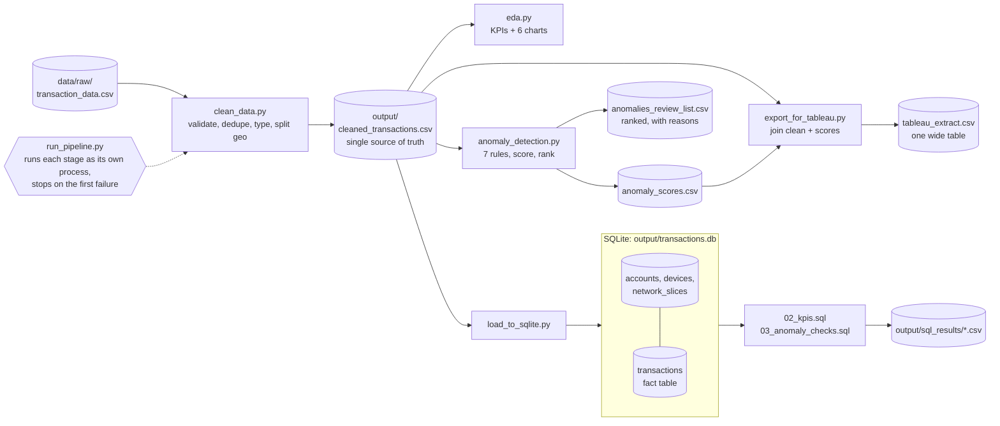

# 🛒 Retail Sales Intelligence & Transaction Anomaly Detection


End to end analytics and anomaly detection pipeline on a 1,000 row
transaction dataset, built with **SQL, Python (pandas, NumPy),
Seaborn/Matplotlib and Tableau**.

> **Result:** One command cleans the data, builds KPIs and 7 charts, scores every transaction against 7 explainable rules, and ships a ranked review list of 69 flagged transactions (6.9%), each with the reasons it was flagged.

See [System design](#system-design) for how the pipeline is built.

## What it does
- **Data cleaning and validation** (`python/clean_data.py`): renames
  columns, removes duplicates, fixes data types, splits geolocation
  into latitude/longitude, and drops invalid rows.
- **KPIs and EDA** (`python/eda.py`): revenue, transaction volume,
  average transaction value, contribution by type and device,
  failed-transaction rate and a 5-minute trend, plus 6 charts in
  `output/charts/`.
- **Rule-based anomaly detection** (`python/anomaly_detection.py`):
  scores every transaction against 7 explainable rules built from
  percentiles and z-scores (pandas + NumPy only). Transactions that
  break 2 or more rules go into a ranked review list. Each row lists
  **why** it was flagged.
- **SQL layer** (`sql/`): a normalized schema with primary and
  foreign keys, KPI queries, and the anomaly rules rewritten in SQL
  with CTEs and window functions (`NTILE`, `SUM() OVER`).
  `python/load_to_sqlite.py` loads the data into SQLite and runs
  every query, so no database server is needed.
- **Tableau** (`dashboard/`): a single wide extract plus a dashboard
  spec.

## Quick start
```bash
git clone https://github.com/sidhantds/Retail-Sales-Intelligence-Transaction-Anomaly-Detection.git
cd Retail-Sales-Intelligence-Transaction-Anomaly-Detection
pip install -r requirements.txt
python run_pipeline.py
```
Outputs land in `output/` and `dashboard/`.

## Key results
| Metric | Value |
|---|---|
| Successful transaction value | 384,742.91 |
| Successful transactions | 487 of 1,000 |
| Average successful transaction | 790.03 |
| Largest contributor | Transfers, 40.9% of value |
| Failed-transaction rate | 48.7% to 53.2% by type |
| Transactions flagged for review | 69 (6.9%) |


## Anomaly rules
| Rule | Fires when |
|---|---|
| `high_amount` | amount is in the top 5% |
| `failed_high_value` | status is Failed and amount is in the top 10% |
| `high_latency` | latency is in the top 5% |
| `low_bandwidth` | bandwidth is in the bottom 5% |
| `burst_minute` | the transaction's minute has a volume z-score above 2 |
| `repeat_account` | sender or receiver account appears in more than one transaction |
| `shared_pin` | the PIN code is used by more than one sender account |

## System design

### Architecture



This is a **batch pipeline**. Every stage reads files and writes files, and the cleaned CSV is the one source all later stages read from. There is no shared memory between stages, so any stage can be rerun alone and any intermediate file can be opened and inspected.

### Design decisions and trade offs

| Decision | Why | Cost |
|---|---|---|
| Stages talk through files | Each step can be rerun and debugged alone; outputs are visible and diffable | Every run recomputes everything; there are no incremental updates |
| `run_pipeline.py` runs each stage with `check=True` | A failed stage stops the chain, so later stages never run on stale or half written data | Stages run one after another even when they could run in parallel |
| Columns renamed **by name**, not position | A source export with reordered columns still loads correctly | A renamed source column breaks cleaning, which is the safer outcome |
| Normalized schema: one fact table, three dimension tables, indexes on timestamp, type and fraud flag | Queries that filter by time or type stay fast, and account data is stored once | Every analysis query needs joins |
| Denormalized wide extract for Tableau | BI tools work best on one flat table | The same data exists twice in different shapes |
| Rules written in **both** pandas and SQL | The two versions cross check each other, and the project shows both skills | One rule now lives in two places, which is a real risk of drift |
| Count of broken rules as the score, distance from normal as the tie break | Every flag explains itself; a reviewer sees exactly why a row is on the list | Every rule counts the same, whatever its real risk |

### How the scoring behaves

The thresholds are **relative to the batch**: "top 5% of amounts" is computed from the data being scored. So the pipeline always flags roughly the same share of transactions, whether the batch is clean or full of fraud. For a recurring job, the thresholds would be frozen from a trusted reference period and then applied to new data, so an unusual day actually produces more flags.

Checked against the dataset's own `fraud_flag`, 53.6% of flagged transactions are labelled fraud, against 48.1% overall. That is only about 1.1 times the base rate, so on this synthetic label the rules are explainable but barely better than chance. That is an honest result to report, not a bug: these rules describe unusual behaviour, and the label does not appear to follow behaviour.

### Scaling

At 1,000 rows everything fits in memory. At millions of rows, pandas memory and SQLite's single writer become the limits. The next step would be DuckDB or a warehouse table partitioned by date, with the pipeline processing one new time window per run instead of the full history.

## Project layout
```
data/raw/            source CSV
python/              cleaning, EDA, anomaly detection, SQLite loader, Tableau export
sql/                 schema, KPI queries, anomaly checks in SQL
output/              cleaned data, KPI summary, reports, charts, SQL results
dashboard/           Tableau extract + dashboard spec
docs/                workflow, assumptions, limitations
run_pipeline.py      runs every step in order
```

## Skills
SQL, SQLite, Python, Pandas, NumPy, Seaborn, Matplotlib, Data Cleaning,
Data Validation, Exploratory Data Analysis, Statistical Anomaly
Detection (z-scores, percentiles), KPI Reporting, Relational Database
Design, Tableau, Data Visualization

## Note on the source data
The dataset is synthetic. It mixes retail-style transaction fields
(amount, type, status) with banking/network fields (PIN code, network
slice, latency), covers only one hour (10:01 to 11:00 on 2025-01-17),
and its `fraud_flag` is set on about 48% of rows, apparently at
random. See `docs/workflow.md` for all assumptions and limitations.
