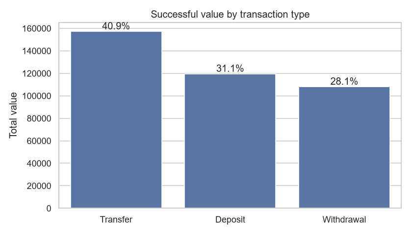
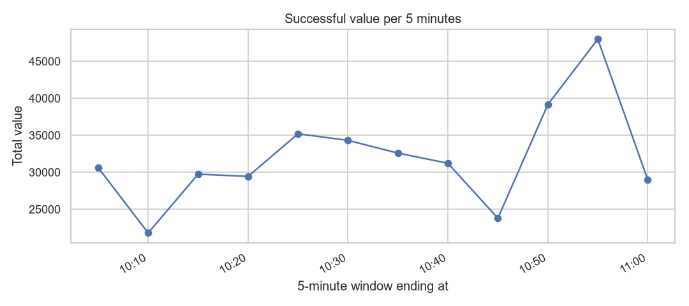
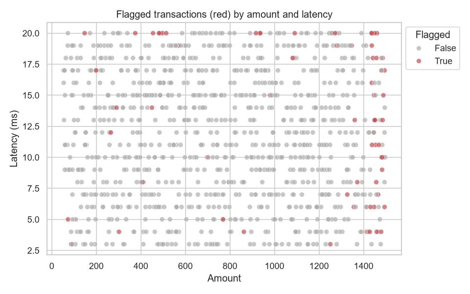

# Retail Sales Intelligence & Transaction Anomaly Detection

End-to-end analytics and anomaly-detection pipeline on a 1,000-row
transaction dataset, built with **SQL, Python (pandas, NumPy),
Seaborn/Matplotlib and Tableau**.

## What it does
- **Data cleaning and validation** (`python/clean_data.py`): renames
  columns, removes duplicates, fixes data types, splits geolocation
  into latitude/longitude, and drops invalid rows.
- **KPIs and EDA** (`python/eda.py`): revenue, transaction volume,
  average transaction value, contribution by type and device,
  failed-transaction rate and a 5-minute trend, plus 6 charts in
  `output/charts/`.
- **Rule-based anomaly detection** (`python/anomaly_detection.py`):
  scores every transaction against 7 explainable rules built from
  percentiles and z-scores (pandas + NumPy only). Transactions that
  break 2 or more rules go into a ranked review list. Each row lists
  **why** it was flagged.
- **SQL layer** (`sql/`): a normalized schema with primary and
  foreign keys, KPI queries, and the anomaly rules rewritten in SQL
  with CTEs and window functions (`NTILE`, `SUM() OVER`).
  `python/load_to_sqlite.py` loads the data into SQLite and runs
  every query, so no database server is needed.
- **Tableau** (`dashboard/`): a single wide extract plus a dashboard
  spec.

## Quick start
```bash
git clone https://github.com/sidhantds/Retail-Sales-Intelligence-Transaction-Anomaly-Detection.git
cd Retail-Sales-Intelligence-Transaction-Anomaly-Detection
pip install -r requirements.txt
python run_pipeline.py
```
Outputs land in `output/` and `dashboard/`.

## Key results
| Metric | Value |
|---|---|
| Successful transaction value | 384,742.91 |
| Successful transactions | 487 of 1,000 |
| Average successful transaction | 790.03 |
| Largest contributor | Transfers, 40.9% of value |
| Failed-transaction rate | 48.7% to 53.2% by type |
| Transactions flagged for review | 69 (6.9%) |





## Anomaly rules
| Rule | Fires when |
|---|---|
| `high_amount` | amount is in the top 5% |
| `failed_high_value` | status is Failed and amount is in the top 10% |
| `high_latency` | latency is in the top 5% |
| `low_bandwidth` | bandwidth is in the bottom 5% |
| `burst_minute` | the transaction's minute has a volume z-score above 2 |
| `repeat_account` | sender or receiver account appears in more than one transaction |
| `shared_pin` | the PIN code is used by more than one sender account |

## Project layout
```
data/raw/            source CSV
python/              cleaning, EDA, anomaly detection, SQLite loader, Tableau export
sql/                 schema, KPI queries, anomaly checks in SQL
output/              cleaned data, KPI summary, reports, charts, SQL results
dashboard/           Tableau extract + dashboard spec
docs/                workflow, assumptions, limitations
run_pipeline.py      runs every step in order
```

## Skills
SQL, SQLite, Python, Pandas, NumPy, Seaborn, Matplotlib, Data Cleaning,
Data Validation, Exploratory Data Analysis, Statistical Anomaly
Detection (z-scores, percentiles), KPI Reporting, Relational Database
Design, Tableau, Data Visualization

## Note on the source data
The dataset is synthetic. It mixes retail-style transaction fields
(amount, type, status) with banking/network fields (PIN code, network
slice, latency), covers only one hour (10:01 to 11:00 on 2025-01-17),
and its `fraud_flag` is set on about 48% of rows, apparently at
random. See `docs/workflow.md` for all assumptions and limitations.
