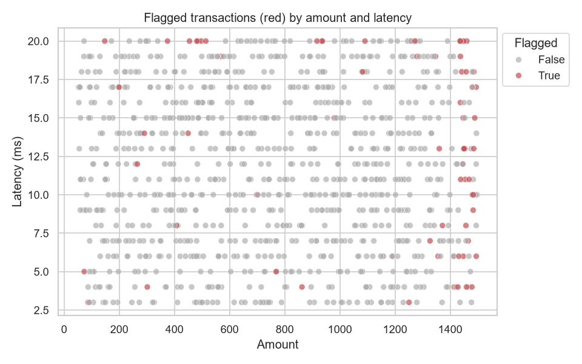

# Anomaly Detection Summary

- Method: rule-based scoring (percentiles + z-scores), flag if score >= 2
- Transactions scored: 1000
- Transactions flagged: 69 (6.9%)
- Flagged transactions that also carry fraud_flag=True: 37 (53.6% of flagged, vs. 48.1% overall)
- Total fraud_flag=True in dataset: 481

## How often each rule fired

```
shared_pin           103
repeat_account        55
failed_high_value     53
burst_minute          53
high_latency          53
low_bandwidth         51
high_amount           50
```

## Transactions by anomaly score

```
anomaly_score
0    660
1    271
2     61
3      7
4      1
```



Flagged transactions are written to `output/anomalies_review_list.csv`, highest priority first, with the reasons for each flag.