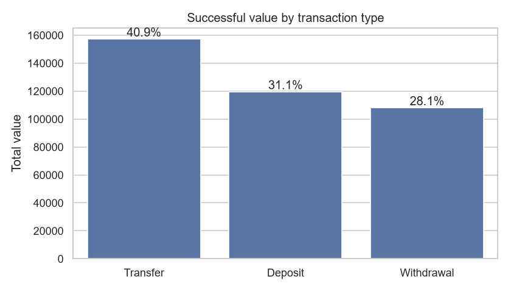
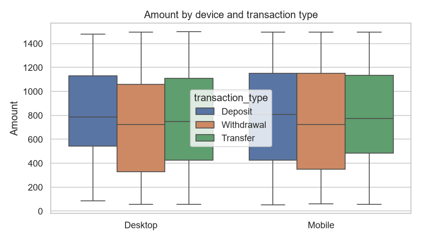
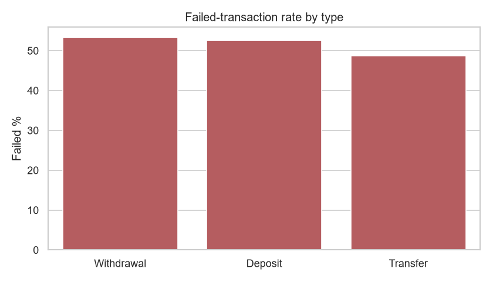
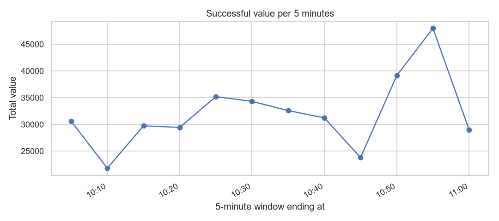
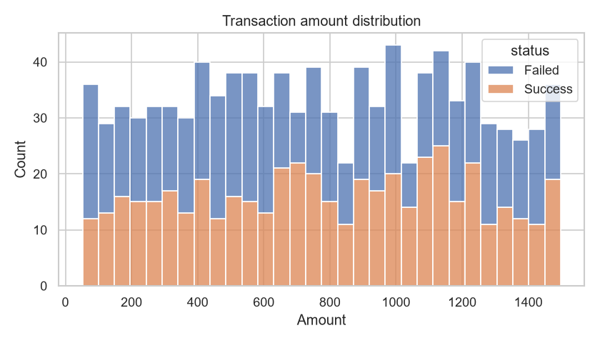
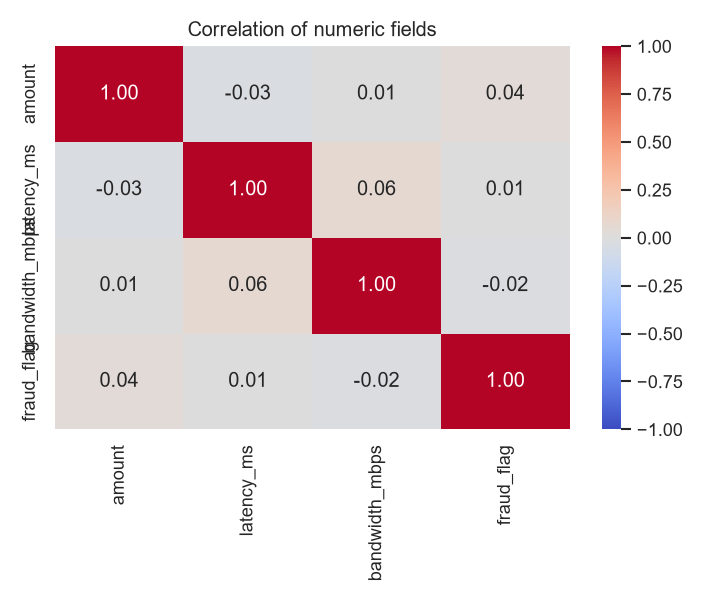

# Exploratory Data Analysis

- Data covers **2025-01-17 10:01** to **11:00** (1000 transactions)
- Total successful transaction value: **384,742.91**
- Successful transaction volume: **487**
- Average transaction value: **790.03**
- Fraud-flagged transactions: **481** (value: 378,863.90)

## Contribution by transaction type

```
                  txn_count  total_value  pct_of_total
transaction_type                                      
Transfer                192    157220.62         40.86
Deposit                 150    119501.08         31.06
Withdrawal              145    108021.21         28.08
```



## Performance by device

```
             txn_count  total_value  avg_value
device_used                                   
Mobile             521    403209.13     773.91
Desktop            479    367956.16     768.18
```



## Failed-transaction rate by type (%)

```
                  failed_pct
transaction_type            
Withdrawal             53.23
Deposit                52.53
Transfer               48.66
```



## Fraud-flag rate by type (%)

```
                  fraud_pct
transaction_type           
Deposit               52.85
Transfer              45.45
Withdrawal            46.45
```

## 5-minute trend (successful transactions)

```
                     txn_count  total_value
txn_timestamp                              
2025-01-17 10:05:00         40     30603.86
2025-01-17 10:10:00         27     21784.97
2025-01-17 10:15:00         34     29730.13
2025-01-17 10:20:00         37     29430.18
2025-01-17 10:25:00         47     35191.83
2025-01-17 10:30:00         38     34302.79
2025-01-17 10:35:00         41     32579.06
2025-01-17 10:40:00         42     31210.39
2025-01-17 10:45:00         32     23782.26
2025-01-17 10:50:00         48     39143.95
2025-01-17 10:55:00         59     47988.86
2025-01-17 11:00:00         42     28994.63
```



## Amount distribution and correlations





Correlations between amount, latency, bandwidth and `fraud_flag` are all close to zero, so `fraud_flag` cannot be predicted from these fields alone.